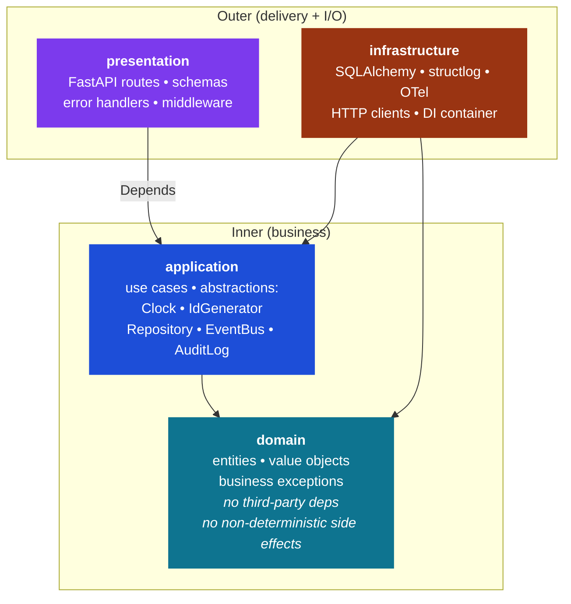
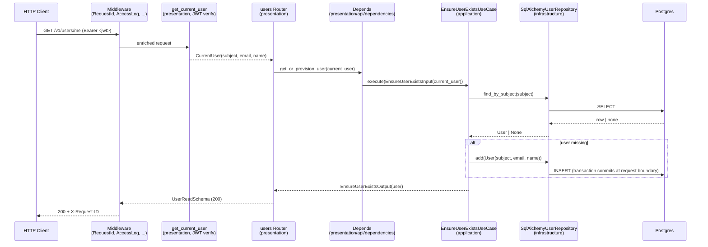

# Architecture

> Single reference document for the architecture of {{ cookiecutter.project_name }}.
> The full design rationale lives in [ADR 0001](adr/0001-clean-architecture.md).

## Overview

{{ cookiecutter.project_name }} is a {{ cookiecutter.project_description }} The codebase follows **Clean Architecture** (Uncle Bob, strict variant) with four concentric layers. Arrows show the **direction of allowed imports** — every arrow points **inward**.



Request flow for `GET /v1/users/me` — illustrates how an authenticated request crosses the layers:



## Dependency rule

A layer may import only from layers below it. Equivalently:

| Layer | May import |
|---|---|
| `domain/` | Python stdlib only (no third party, no non-deterministic side effects) |
| `application/` | `domain/` |
| `infrastructure/` | `domain/`, `application/` |
| `presentation/` | `application/`, `domain/` (types only) — **never** `infrastructure/` directly |

Concrete implementations are injected from `infrastructure/container.py` via FastAPI `Depends` wrappers in `presentation/api/dependencies/`.

## Folder layout

```
src/{{ cookiecutter.package_name }}/
├── domain/
│   ├── entities/           # User, Order, ... (regular classes, identity equality)
│   ├── value_objects/      # Email, Money, UserId, ... (frozen dataclasses)
│   └── exceptions/         # DomainError + subclasses by bounded context
├── application/
│   ├── use_cases/          # 1 file = 1 use case, ...UseCase suffix
│   ├── repositories/       # protocols (UserRepository, ...)
│   ├── clock.py            # Clock protocol
│   ├── id_generator.py     # IdGenerator protocol
│   ├── random_source.py    # RandomSource protocol
│   ├── event_bus.py        # EventBus protocol
│   ├── audit_log.py        # AuditLog protocol
│   └── dtos/               # ...Input / ...Output frozen dataclasses
├── infrastructure/
│   ├── persistence/        # SQLAlchemy ORM + concrete repositories
│   ├── observability/      # structlog + OTel setup, @traced decorator
│   ├── config/             # Pydantic Settings
│   ├── container.py        # pure factory functions
│   ├── clock.py            # SystemClock
│   ├── id_generator.py     # Uuid4IdGenerator
│   └── random_source.py    # SystemRandomSource
└── presentation/
    └── api/
        ├── app.py          # FastAPI factory
        ├── v1/             # routers per resource
        ├── schemas/        # Pydantic ...Schema
        ├── dependencies/   # Depends wrappers around the container
        ├── middleware/     # SecurityHeaders, ...
        └── error_handlers.py  # DomainError → HTTP mapping
```

## Tests pyramid

```
tests/
├── unit/           # Fakes only (no Mock). Mutation testing target.
│   ├── domain/
│   ├── application/
│   └── presentation/
├── integration/    # testcontainers Postgres / Redis
│   └── infrastructure/
├── e2e/            # FastAPI app booted, 1 happy + 1 critical-error per endpoint
│   └── api/
└── fakes/          # FrozenClock, SequentialIdGenerator, InMemoryRepository, ...
```

See ADR [0002](adr/0002-tdd-and-mutation-testing.md) and [0003](adr/0003-fakes-only-in-unit-tests.md).

## Multi-layer guardrails

| Layer | Mechanism | What it enforces |
|---|---|---|
| Claude Code | `CLAUDE.md` + skills + hooks (settings.json) | Architecture, TDD, naming, no-mock, mapping HTTP, etc. |
| Pre-commit | `.pre-commit-config.yaml` | ruff, format, gitleaks, custom lints, commitizen |
| Git hooks | `commit-msg` + `pre-push` | Conventional Commits, pytest unit |
| CI | GitHub Actions | Everything: ruff, ty, pytest 3 levels, mutmut ≥90%, bandit, pip-audit, helm lint, kubeconform, polaris |

A new convention is enforced at **at least two layers**, so that no single bypass can introduce drift.

## Production posture

### HTTP middleware stack

Outermost to innermost: `RequestId` → `AccessLog` → `BodySizeLimit` → `RequestTimeout` → `CORS` → `SecurityHeaders` → handler.

* `RequestId` accepts an upstream `X-Request-ID` or generates a UUID4 hex; binds it to the structlog context so every log line in the request scope carries it; echoes it back on the response.
* `AccessLog` emits one structured `http.request` event per request with method, path, status, duration_ms, client. `/health/*` paths are silenced.
* `BodySizeLimit` rejects requests whose `Content-Length` exceeds `request_max_body_bytes` (default 1 MiB) with a 413.
* `RequestTimeout` caps each request at `request_timeout_seconds` (default 30s) via `asyncio.wait_for`; on overrun it returns 504 and the handler coroutine is cancelled.

### Prometheus metrics

`prometheus-fastapi-instrumentator` exposes `/metrics` (always on, excluded from the OpenAPI schema). Out of the box: HTTP request count + duration histogram + in-progress gauge per `(method, handler, status)`, plus `prometheus_client` process metrics (CPU, memory, fds, uptime). `/metrics` itself and `/health/*` are excluded from the instrumentation to avoid feedback noise.

The Helm chart ships a `ServiceMonitor` (gated by `metrics.enabled`) pointing at `/metrics` so a Prometheus operator picks it up automatically.

### Graceful shutdown

Aligned across two layers:

* uvicorn ships with `--timeout-graceful-shutdown 30` (Dockerfile `CMD`) — drains in-flight requests for up to 30s after SIGTERM.
* Helm `terminationGracePeriodSeconds: 35` is strictly greater than 30 so K8s never SIGKILLs before the drain completes.

### Image supply chain (CI)

* `ci-image-scan.yml` (PR): builds the image, runs Trivy (fails on HIGH/CRITICAL with a known fix), produces a CycloneDX SBOM artefact.
* `release.yml` (tag): rebuilds, scans, pushes, signs with `cosign` (keyless via Sigstore + GitHub OIDC), attaches the SBOM as a Sigstore attestation, attaches the SBOM JSON to the GitHub Release.

Verify a release locally:

```bash
cosign verify ghcr.io/<org>/<repo>:vX.Y.Z \
  --certificate-identity-regexp '^https://github.com/<org>/<repo>/.github/workflows/release\.yml@.*' \
  --certificate-oidc-issuer 'https://token.actions.githubusercontent.com'
```
